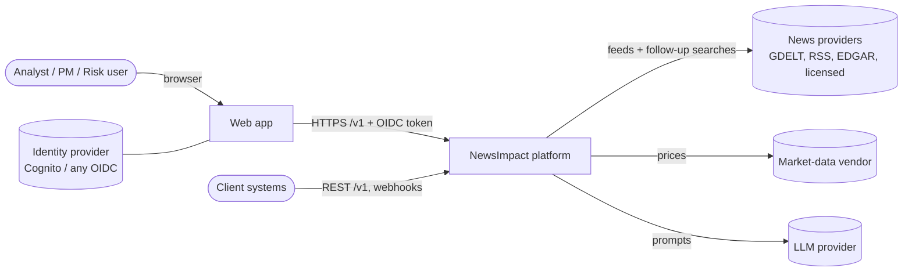
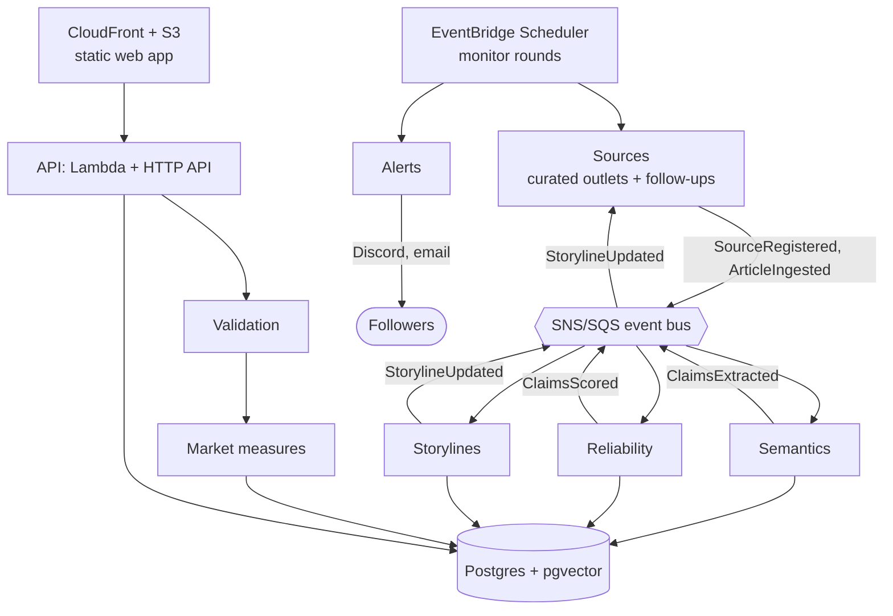

# Architecture

C4 diagrams in Mermaid; decisions in [adr/](adr/). The guiding rule:
**every folder and file exists for one stated reason, and the structure is
enforced by CI, not by memory.**

## C4 Level 1 – System context



## C4 Level 2 – Containers (target on AWS)



Today every box runs in **one process** with an in-memory bus. A box becomes
its own deployable by giving it its own small wiring file – no business-code
changes.

## The pipeline, in the order news flows

```
   monitor (every hour) ─▶ ① sources ─ArticleIngested─▶ ② semantics ─ClaimsExtracted─▶ ③ reliability
                               ▲                                                          │ ClaimsScored
                               └── StorylineUpdated: search the ◀───── ④ storylines ◀─────┘
                                   listed sources for the next update        │
                                                                             ▼
                              ⑤ market (price, volume, swings) ─▶ ⑥ validation ─▶ confirmed? as expected?
                                                                             │
                              app/views (priority, checks, briefs) ─▶ website / API, alerts
```

Which companies get their own news feed and AI reading is decided each round by
`app/following.py` (the round's "follow" step, ADR 0036): any S&P 500 or ASX 200
member (`universe.json`) that the news names often enough, plus every starred company.

| # | Module | Answers | Publishes |
|---|---|---|---|
| ① | `sources` | Which outlets do we watch, and what did they publish? | `SourceRegistered`, `ArticleIngested` |
| ② | `semantics` | What is claimed, about which company, what kind of event, which signals, which side of a deal? | `ClaimsExtracted` |
| ③ | `reliability` | How far should we trust this outlet and this claim? | `ClaimsScored` |
| ④ | `storylines` | Which story is this part of, which stage, which decisions follow? Which outlets reported it? | `StorylineUpdated` |
| ⑤ | `market` | What did prices, volume and volatility actually do? | – (queried) |
| ⑥ | `validation` | Is each stage backed by independent origins, did the expected decisions show up in the market, what do we conclude, and do playbooks hold across many stories? | – (queried) |
| – | `alerts` | What changed for the companies each person follows, and telling them (Discord; email next) | – (sends messages) |
| – | `identity` | Who is signed in and what they may do: `User` (id, email, roles) and the `Authenticator` port (local single user now; Amazon Cognito next) | – |
| – | `llm` | Platform module: one budgeted, cached gateway to local or hosted language models (semantics step, event briefs) | – |

The design separates **what the news claims and predicts** (①–④) from
**independent evidence** (other sources, the company, filings, market data)
used to check it (⑤–⑥). Conclusions never rest on the news alone.

## Repository map – why each part exists

| Path | Why it exists |
|---|---|
| `src/newsimpact/<module>/` | One business module from the table above. Every module has the same files (next section). |
| `src/newsimpact/shared/` | The small toolkit every module uses: event base classes, event bus, text ids, and the SQLite helper that only adapters may use. Imports nothing else. |
| `src/newsimpact/app/` | Settings (`config.py`), the hourly round (`monitor.py`: `ROUND`, one line per step), which companies we follow (`following.py`), the MCP server (`mcp.py`), demo loader, logging. The only place that picks technologies. |
| `src/newsimpact/app/wiring/` | `plugins.py`: one table per kind of technology (storage, event bus, feeds, market data, AI providers, text steps, sign-in, alert channels), picked by name; `__init__.py` builds the services in the order news flows. |
| `src/newsimpact/app/api/` | The HTTP API: `routes/` has one router file per area (system, companies, storylines, sources, alerts, monitor, assistant), listed in `ROUTES`; the website is served at `/`. |
| `src/newsimpact/app/views/` | What the website and API show, composed from the modules: companies and events, priority and "what to check now" (rules), each event type's record against research and chance, three-line briefs (AI from our facts, rules fallback), system status, the per-round snapshot pages read, and what the assistant may look up. |
| `web/` | The website (React + TypeScript). `src/routes.tsx` lists every page. `src/features/<page>/` holds one folder per page (watchlist, event, method). `src/shared/` holds UI parts (badges, charts, visuals, the price chart, the ticker, the Ask NewsImpact assistant), `labels.ts` (the only place that turns codes into plain English, including every hover definition) and data hooks. `src/api/` holds the client, generated from the server's OpenAPI document, so API changes that break the site fail CI. |
| `tests/<module>/`, `tests/app/`, `tests/e2e/` | Tests mirror `src/`; `app/` covers the API, views and monitor; e2e runs the whole demo pipeline. |
| `schemas/events/` | Generated JSON Schemas of every event, for non-Python consumers. CI fails on drift. |
| `data/reference/` | Real, curated knowledge edited without code, each value with its reason: **outlets** (`sources.json`), what to look for in text (`taxonomy.json`), storyline playbooks, the companies we can recognise (`universe.json`: S&P 500 + ASX 200) and how the news writes their names (`entities.json`), **measurement and validation thresholds** (`methodology.json`), LLM prices. See [07-coverage-and-settings](07-coverage-and-settings.md). |
| `data/eval/` | Hand-labelled sentences: the quality gate for any analysis chain (word lists, LLM). |
| `data/demo/` | Fictional outlets, news, track records and prices for the offline demo and tests. Same formats as `reference/`. |
| `scripts/` | Contract exports (event JSON Schemas, the OpenAPI document) and `refresh_universe.py`, which rebuilds `universe.json` from the index lists (quarterly). |
| `infra/terraform/` | Cloud infrastructure as code (currently: cost guardrails only). |
| `docs/` | Product, architecture, research, cost plan, ADRs. |
| `var/` (git-ignored) | Local state when `NI_STORE=sqlite` (created on first run). |

### Inside every module (same file names everywhere)

| File | Holds | May import |
|---|---|---|
| `__init__.py` | The module card: purpose, how to extend it, what it publishes and consumes | – |
| `models.py` | Its data and the events it publishes (`PUBLISHES`) – the only file other modules may import | `shared`, other modules' `models` |
| `logic.py` | Pure calculations and rules, no I/O (only where there are any: every module except storylines and identity) | `models` |
| `ports.py` | Interfaces to the outside world it needs (stores, feeds, analyzers) | `models` |
| `service.py` | The workflow: react to events → use logic and ports → publish events | all of the above + `shared` |
| `adapters/` | One file per technology implementing a port, named after the technology (`rss.py`, `gdelt.py`, `json_file.py`, `memory.py`, …) | anything |

Reading order for a newcomer: `__init__.py` → `models.py` → `service.py`.

## Rules (enforced by `make arch`, see pyproject.toml)

1. `shared` imports nothing else from newsimpact.
2. Modules are independent: they may use each other's **`models.py` only**,
   never another module's service, ports or adapters. They talk through events.
3. `models.py` is pure data: no services, ports, adapters or app.
4. Business logic (`models`, `logic`, `ports`, `service`) never imports
   technology (`adapters`, `shared.sqlite`) or `app`.

## How to extend

| I want to… | Do this | Code change? |
|---|---|---|
| **Watch another outlet** | Add a row to `data/reference/sources.json` (id, type, domains, feed URL). Monitored and tracked for reliability from the next round. | None |
| Pause an outlet | `"enabled": false` in its row | None |
| Read a new **kind** of feed (licensed news API, EDGAR full-text…) | New file in `sources/adapters/`, one entry in `FEEDS` (`app/wiring/plugins.py`), use the new `kind` in `sources.json` | 1 file + 1 line |
| Search beyond the listed outlets | `NI_ACCEPT_UNLISTED_SOURCES=true` – unlisted outlets get the "unknown" reliability prior and `listed=false` | None |
| **Detect a new kind of event**, aspect, or word list | Edit `data/reference/taxonomy.json` (bump its `version`) | None |
| **Measure something new in the text** (framing, numbers, forward-looking…) | New `ClaimStep` in `semantics/adapters/`, register it in `SEMANTIC_STEPS` (`app/wiring/plugins.py`), add its name to `NI_SEMANTIC_STEPS`. Results go in `Claim.signals` – no schema change. | 1 class + 1 line |
| Switch analysis technique (LLM) | Adapter implementing `ClaimExtractor` / `ClaimStep`, fed by the same taxonomy | 1 file + wiring |
| Add a storyline type | Add a playbook to `data/reference/playbooks.json` (its event types must exist in the taxonomy – checked at start-up) | None |
| **Validate with a new kind of evidence** (credit spreads, analyst revisions, peers) | Data port + adapter in `market/`, one branch in `MarketService.observe()`; validation picks it up through the decision's `market_channel` | 1 adapter + 1 branch |
| Change how conclusions are drawn | Thresholds: `methodology.json` (with reason). Rules: `validation/logic.py` (pure, unit-tested); bump `MODEL_VERSION` | data / rules only |
| **Use an LLM** for analysis | `NI_LLM_PRESET=quality` (Claude Opus 5.5), `economy` (Claude Haiku 5.5) or `local` (Ollama, $0); presets and reasons in `llm_models.json`; set `NI_LLM_MONTHLY_BUDGET_USD`; compare with `GET /v1/evaluation` first | settings only |
| Add an LLM provider | One adapter implementing `LlmProvider` in `llm/adapters/`, one entry in `LLM_PROVIDERS` (`app/wiring/plugins.py`) | 1 file + 1 line |
| Connect market data | `NI_MARKET_DATA=eodhd` + `NI_EODHD_API_KEY` (US + ASX), or `csv` (vendor exports); a new vendor = one `MarketData` adapter + one entry in `MARKET_DATA` (`app/wiring/plugins.py`) | settings / 1 file + 1 line |
| **Watch another market** | Add an exchange (time zone, close, benchmark, vendor code) and its ticker suffix to `methodology.json` → market; add its index to `PAGES` in `scripts/refresh_universe.py` and run `make universe` | data + 1 line |
| Change a window or threshold | Edit `methodology.json` / `playbooks.json` with its reason, bump version; check it on How it works | data only |
| Monitor on a schedule in the cloud | EventBridge Scheduler → a function calling `app.monitor.run_round()`, or one per step with `run_step()` | deployment only |
| Replace storage (Postgres) | `adapters/postgres.py` in each storing module, one entry in `STORES` (`app/wiring/plugins.py`), then `NI_STORE=postgres` | 1 file per module + 1 line |
| Add a module | New folder with the files above (copy `alerts/` as the smallest example); add it to the two import-linter lists in `pyproject.toml`; build it in `app/wiring/__init__.py`. Its events are exported automatically. | new module |
| **Add a sign-in provider** (Amazon Cognito) | `identity/adapters/cognito.py` (verify the sign-in token, read the user's id, email and groups), one entry in `AUTH` (`app/wiring/plugins.py`), then `NI_AUTH=cognito`. Followed companies and alerts are already per user. | 1 file + 1 line |
| **Add an alert channel** (email, Slack) | One `Notifier` adapter in `alerts/adapters/`, one entry in `NOTIFIERS` (`app/wiring/plugins.py`); every configured channel is used | 1 file + 1 line |
| Change what counts as urgent, or the checklist | `app/views/guidance.py` (small, documented rules; tests in `tests/app/test_views.py`) | rules only |
| Change the brief | the prompt and checks in `app/views/briefs.py`; the facts it may use in `brief_facts` (`app/views/companies.py`) | 1 file |
| **Add a website page** | A folder in `web/src/features/`, one entry in `web/src/routes.tsx`, its styles as one group in `web/src/styles.css`; new words get a definition in `TERMS` (`shared/labels.ts`) | new folder + 1 line |
| **Add API endpoints** for a feature | `app/api/routes/<feature>.py` with `router(api)`, one entry in `ROUTES` (`app/api/__init__.py`); then `make contracts` regenerates the website's typed client | 1 file + 1 line |
| **Add a step to the hourly round** | A function in `app/monitor.py` and one line in `ROUND` (order matters) | 1 function + 1 line |
| **Add a company outside the indexes** | An entry in `data/reference/entities.json` with a `why`; without one it is ignored | None |
| Change who is followed | `methodology.json` → following (articles needed, window, how long kept, maximum, discovery per round), each with its reason | None |
| **Refresh the index lists** | `make universe` (runs `scripts/refresh_universe.py`) after each quarterly index review; check the diff of `universe.json` | None |

Every change: tests in `tests/<module>/`, `make check`, ADR if a decision was made.

## Testing each kind of change

Tests mirror the code, so the place for a new test is always the folder of the
thing you changed:

| You changed… | Add or update tests in | Kind |
|---|---|---|
| a rule in a module (`logic.py`) | `tests/<module>/test_logic.py` | pure functions, no I/O |
| a module's workflow (`service.py`) | `tests/<module>/test_service.py` | in-memory adapters |
| an adapter (`adapters/<tech>.py`) | `tests/<module>/test_adapters.py` (or `test_<tech>.py`) | fake network (`httpx.MockTransport`) or a temp SQLite file |
| a plug-in table, a round step | `tests/app/test_plugins.py`, `tests/app/test_monitor.py` | names and order |
| who is followed (`app/following.py`) | `tests/app/test_following.py`, `tests/app/test_views.py` | the rule, pure |
| an API route or a view | `tests/app/test_api.py`, `tests/app/test_views.py` | the demo profile through the real wiring |
| reference data | `tests/e2e/test_reference_data.py` | the real files load and agree |
| the reading chain | `tests/semantics/test_evaluation.py` | the quality gate on `data/eval/` |

`tests/conftest.py` pins the environment, so tests never read your `.env` or
touch the network; `make check` runs them all with the other checks.

## Moving to the cloud, or to another language

Nothing in the modules changes; each move is a plug-in or a wiring choice:

| Move | How |
|---|---|
| Run the hourly round as cloud jobs | One scheduled function per step: `app.monitor.run_step(svc, "collect")`, `"assess"`, … (or `run_round()` for all) |
| Split a module into its own service | Add a cloud bus to `EVENT_BUSES` (SNS/SQS or EventBridge) and set `NI_EVENT_BUS`; the service gets its own small wiring that builds just that module |
| Rewrite one module in another language | The new service reads and publishes the same events: their JSON Schemas are in `schemas/events/` (CloudEvents envelope); stop building the Python module in the wiring |
| Another client (mobile app, partner) | Uses the same `/v1` API; its OpenAPI document is `web/openapi.json` |
| Postgres instead of SQLite | `adapters/postgres.py` per storing module + one `STORES` entry |

## Words on the website and in the code

The code keeps a few older names where the website uses plainer ones. In the
code, "event" already means a message on the event bus, so a news event needs
another word there:

| On the website | In the code | Why it differs |
|---|---|---|
| event | storyline (`storylines` module, `Storyline`) | "event" is a bus message in code |
| update | stage (`StorylineEvent`, `stage_name`) | stages of a playbook |
| source | outlet in a few fields (`claim.outlets`, `OutletCoverage`) and source elsewhere | older name; new code says source |
| confirmed | `verified`, claim status `corroborated` / `confirmed` | – |
| what to check now | `checks` | – |

New code and new API fields use the website's words where they do not clash.

## Reproducibility

Every result can be traced to exactly what produced it:

| What | How |
|---|---|
| Code and dependencies | `uv.lock` pins every package; the same Docker image runs locally and in the cloud |
| Analysis method | every claim carries `model_version` = the extractor and each step in order, incl. taxonomy version |
| Reference data | each assessment's `provenance.reference_data` holds content hashes of sources, entities, the index lists (`universe.json`), taxonomy, playbooks, methodology and LLM prices |
| Analysis quality | `GET /v1/evaluation` scores any chain on `data/eval/`; a test gate stops regressions |
| Market data | CSV snapshots or cached vendor bars; provider version in provenance |
| Models and rules | reliability, storylines, market and validation each stamp a `MODEL_VERSION`, collected in `provenance.components` |
| Time | point-in-time fields (`published_at`, `ingested_at`, `as_of`); articles processed in publication order |
| Demo and tests | fixed fictional data and seeded synthetic prices – same output on every machine |

## Frontend and integration (ADR 0009)

**API-first:** the web app is one client of the same versioned `/v1` API that
customers integrate with, so nothing the UI can do is unavailable to an
integration and vice versa.

| Concern | Choice | Replaceable because |
|---|---|---|
| Web app | React + TypeScript + Vite in `web/`, served by the API at `/` (or any static host) | Talks only to the OpenAPI contract |
| Typed API client | Generated from `/openapi.json` (openapi-typescript) | Contract drift fails the frontend build in CI |
| Data fetching / charts | A small `useApi` hook; charts are plain SVG and HTML (no chart library), colours from validated tokens | Isolated in feature folders and `shared/` |
| Auth | OIDC (Amazon Cognito first) | Standard OIDC library – switch IdP by config |
| Hosting | S3 + CloudFront (≈ $1/month at pilot scale) | Static files run anywhere |
| Integrations | REST `/v1`; alerts through the `alerts` module (Discord now; email, Slack, webhooks as more `Notifier` adapters); later CSV/Parquet export | One adapter per channel |
| Multi-tenancy | `tenant_id` from the token → events → row-level security | Already on every event envelope |

Screens today: Watchlist (key numbers, impact map, the companies feed, a
Priorities board), Event (brief, checklist, chart, timeline, expected vs
actual) and How it works (sources, event types, does it move the stock). The
Ask NewsImpact assistant and the latest-events ticker are on every page.

## Scaling path

| Pressure | Response |
|---|---|
| More articles | scale semantics workers horizontally (stateless, SQS fan-out) |
| One module needs its own runtime/scaling | give it its own wiring file + deployable |
| Throughput beyond SQS economics | Kafka/Kinesis adapter behind `EventBus` |
| Heavy analytics/backtests | Parquet on S3 + Athena/DuckDB; Postgres stays for serving |
| Many clients | tenant isolation, per-tenant quotas, API keys + usage metering |

## Language scalability

**Programming languages:** every event is exported as JSON Schema and the API
as OpenAPI, so a Go/Rust/TypeScript service or the frontend joins without
Python changes. **News languages:** `Article.language` + English pivot
(`translated_body`) or multilingual models; GDELT already returns
multilingual results.
