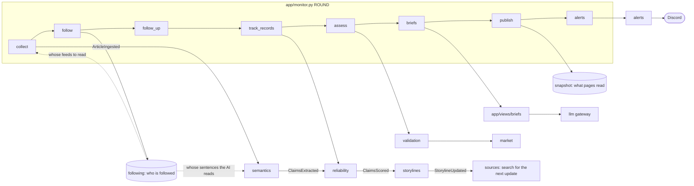

# Codebase guide: what every part does, how the parts connect, where to change things

Read this before adding, changing or removing a feature. It explains the code
from the outside in: the four layers, the two flows that run through them, then
every folder and file, then step-by-step recipes. Why each design choice was
made is in [03-architecture](03-architecture.md) and the [ADRs](adr/).

## 1. Four layers, one direction

```
 data/reference/*.json      what we know (sources, companies, event types, thresholds) - edited, not coded
        │
 src/newsimpact/<module>/   business modules: each answers one question (sources, semantics, ...)
        │                   they never import each other's code, only each other's data (models.py),
        │                   and they talk through events on the bus
        │
 src/newsimpact/app/        composition: picks technologies (wiring), runs the hourly round (monitor),
        │                   shapes data for people (views), serves it (api)
        │
 web/src/                   the website: pages (features/) built from shared parts (shared/)
```

Dependencies point **down** this list only: the website calls the API; the
API calls views and modules; modules use `shared/`. Nothing lower knows
about anything higher. CI enforces the module rules (`make arch`).

## 2. Two flows through the layers

### The hourly round: how news becomes an event (`app/monitor.py`)

`ROUND` lists the steps; each step calls one service. The collect and
follow_up steps start a chain of **events on the bus**: each module reacts to
the event before it. The follow step can start it too, for companies it newly
follows.



| Step | Calls | What happens |
|---|---|---|
| collect | `sources.collect()` | reads every enabled feed (per-company feeds: followed companies plus this round's discovery slice), drops duplicates, stores articles, publishes **ArticleIngested** for each |
| ↳ | `semantics` (on ArticleIngested) | splits the article into claims (company, event type, who said it, rumour, tone) for followed companies only, publishes **ClaimsExtracted** |
| ↳ | `reliability` (on ClaimsExtracted) | scores each claim by its source's reliability, publishes **ClaimsScored** |
| ↳ | `storylines` (on ClaimsScored) | joins claims into events (storylines) update by update using the playbooks, publishes **StorylineUpdated** |
| ↳ | `sources` (on StorylineUpdated) | remembers to search for that event's possible next step |
| follow | `app/following.refresh()` | counts which index members the recent articles name, decides who is followed (3 articles in 7 days; kept for 30 days after its last article or event; starred companies always; at most 150: `methodology.json` "following"), moves the discovery slice on (30 others per round), and sends the last 7 days of articles about newly followed companies back to semantics (**ArticleIngested**) |
| follow_up | `sources.follow_up()` | searches the listed sources for those next updates (GDELT) |
| track_records | `validation.track_records()` → `reliability.set_corroboration()` | each source's reliability learns from how often others confirmed its reports |
| assess | `validation.assess_and_store()` | checks every event: confirmed by independent sources? did the market react as expected? (asks `market`) |
| briefs | `app/views/briefs.ai_brief()` | writes three-line briefs for events whose facts changed (language model, checked) |
| publish | `app/views/snapshot.publish()` | computes what the pages show once from the last 30 days of articles (`methodology.json` "pages"): followed companies, events, coverage per company and per source, each event type's record; stores it with its time and reading method, and logs companies with no news for 7 days |
| alerts | `alerts.check()` | tells each user what changed for the companies they starred (from the snapshot) |

The demo profile has no `universe.json`, so the follow step does nothing there and
every company in its `entities.json` is followed.

### A page request: how the website gets its data

```
browser ─▶ web/src/routes.tsx ─▶ features/<page>/ ─▶ shared/useApi + api/client.ts
        ─▶ GET /v1/... ─▶ app/api/auth.py (who is it?) ─▶ app/api/routes/<area>.py
        ─▶ app/views/<view>.py (shape it) ─▶ module services and stores ─▶ JSON back
```

Example, the watchlist: `WatchlistPage.tsx` calls `api.companies()` →
`GET /v1/companies` → `routes/companies.py` → `views/snapshot.latest()`, the
snapshot the last round published. It was built by `views/companies.companies()`,
which reads stored events, assessments, prices and briefs, and adds each event's
priority and checklist (`views/guidance.py`). Pages never re-read every article (a round reads
one fixed window), so they stay fast as companies and history grow; a snapshot older than the
server start is rebuilt on first read.

## 3. Every folder and file

### `src/newsimpact/` – business modules

Every module has the same files, so each reads the same way:

| File | Holds |
|---|---|
| `__init__.py` | the module card: what it answers, how to extend it, what it publishes and consumes |
| `models.py` | its data classes and the events it publishes (`PUBLISHES`), the only file others may import |
| `logic.py` | pure rules and calculations, no input/output (easy to unit-test) |
| `ports.py` | interfaces it needs from the outside world (stores, feeds, vendors) |
| `service.py` | the workflow: react to events or calls, use logic and ports, publish events |
| `adapters/` | one file per technology implementing a port (`rss.py`, `sqlite.py`, `eodhd.py`, ...) |

| Module | Answers | Key files | Publishes → consumed by |
|---|---|---|---|
| `sources/` | What did our news sources publish? | `service.py` (collect, follow up), `adapters/rss.py` (feeds, per-company feeds for the tickers the wiring hands it), `adapters/gdelt.py` (search), `logic.py` (copy detection, coverage) | SourceRegistered → reliability; ArticleIngested → semantics |
| `semantics/` | What does each sentence claim, about whom, what kind of event? | `service.py` (chain, commentary filter, followed companies only), `adapters/lexicon.py` (`SentenceExtractor`: all company names as one pattern; word lists), `adapters/json_file.py` (company names: `universe.json` + `entities.json`), `adapters/llm_classifier.py` (AI step), `logic.py` (deal role: buyer, target or seller; accuracy scoring) | ClaimsExtracted → reliability |
| `reliability/` | How far to trust each source and claim? | `logic.py` (starting estimates, Beta posterior, noisy-OR), `service.py` (scores, corroboration record) | ClaimsScored → storylines |
| `storylines/` | Which event does a claim belong to, and which update is it? | `service.py` (linking, late reports, an absorbed type joining an open event), `models.py` (Storyline, Playbook with its expectations per case), `adapters/json_file.py` (playbooks) | StorylineUpdated → sources |
| `market/` | What did price, volume and price swings do? | `service.py` (event study, observations, price path), `logic.py` (statistics), `adapters/eodhd.py`, `adapters/cached.py` | – (asked by validation and views) |
| `validation/` | Is each update confirmed, did the market react as expected, what do sources' records say? | `logic.py` (claim check, verdicts, track records, calibration), `service.py` | – (asked by the round and the API) |
| `alerts/` | What changed for each user's companies, and telling them | `logic.py` (which changes matter), `service.py` (per user), `adapters/discord.py`, `adapters/shared.py` | – (sends messages) |
| `identity/` | Who is signed in, and are they an admin? | `models.py` (User), `ports.py` (Authenticator), `adapters/local.py` | – (asked on every request) |
| `llm/` | One budgeted, cached gateway to language models | `service.py` (cache → budget → call → ledger; `run_tools`: a tool-calling loop, every step priced and recorded), `adapters/anthropic_api.py` (structured output; the SDK's tool runner), `adapters/ollama.py` | – |
| `assistant/` | Answer a person's question from our own data | `logic.py` (the read-only tools, the instructions, the Notebook every answer must rely on), `service.py` (daily limit → tools → checks), `adapters/` (question counts) | – (asked by the API; its tools are also served over MCP) |
| `shared/` | The toolkit every module uses | `events.py` (event envelope), `bus.py` (event bus), `sqlite.py` (storage helper), `text.py` (ids), `guardrails.py` (no advice words, every number from our data) | – |

### `src/newsimpact/app/` – composition

| Path | Does | You touch it when |
|---|---|---|
| `config.py` | all `NI_*` settings from `.env` | adding a setting |
| `wiring/plugins.py` | one table per kind of technology: `STORES`, `EVENT_BUSES`, `FEEDS`, `MARKET_DATA`, `LLM_PROVIDERS`, `SEMANTIC_STEPS`, `AUTH`, `NOTIFIERS` | adding or swapping a technology |
| `wiring/__init__.py` | `build_services()`: builds every service in the order news flows; `Services` holds them | adding a module |
| `monitor.py` | `ROUND` (the hourly steps), `run_round()`, `run_step()`, the background timer | adding a step to the round |
| `following.py` | which companies are followed: `decide()` (the rule, pure), `feed_tickers()` (followed + discovery slice), `followed_companies()` (what pages show), `refresh()` (the round step), its store | changing who is followed (the numbers are in `methodology.json`) |
| `api/__init__.py` | `create_app()`: the routers in `ROUTES`, sign-in on every `/v1` route, the website at `/` | adding an area of endpoints |
| `api/auth.py` | `current_user`, `admin_user`: who is calling, are they allowed | changing access rules |
| `api/context.py` | what every router may use (services, monitor, per-process cache) | rarely |
| `api/routes/*.py` | one file per area: `system`, `companies`, `storylines`, `sources`, `alerts`, `monitor`, `assistant` | adding or changing endpoints |
| `mcp.py` | MCP server: the assistant's tools for AI assistants (Claude Desktop, Claude Code), over stdio; `make mcp` | offering a new tool to outside AIs (add it to the toolbox instead) |
| `views/companies.py` | followed companies and their events for the website: cards, measures (move and its days, moves shared with another event, a small line of the stock vs its index), the company's part in a deal, the expected move for its case, the record of past events of that case (without this event), facts for briefs | showing new data about events |
| `views/guidance.py` | priority (Act now / Check / Background) and "what to check now" rules; `group_record()`: did a case's events move as research expects, judged against chance | changing urgency, the checklist or how a record is judged |
| `views/briefs.py` | three-line briefs: AI prompt, safety checks, rules fallback, brief store | changing the brief |
| `views/system.py` | overview counts, source coverage, reading accuracy, `TypeStats` per event type (`GET /v1/event-types`) | changing status numbers |
| `views/snapshot.py` | what pages read, computed once per round: company cards, coverage per company and source, event-type records (`types`), with time and reading method; its store | adding a page that reads many articles or events |
| `views/news_data.py` | what the assistant's tools may read (snapshot + stored articles), formatted as on the website | giving the AI more facts to look up |
| `demo.py` | runs the fictional demo data through the real pipeline | changing the demo |
| `logs.py` | JSON logs, with keys and webhook links blanked out | rarely |

### `web/src/` – the website

| Path | Does |
|---|---|
| `main.tsx`, `App.tsx` | start the app; header, navigation, live status |
| `routes.tsx` | the one route table: URL → page |
| `api/client.ts` | one function per API call; `schema.ts` is generated from the API (`make contracts`) |
| `features/watchlist/` | home: `WatchlistPage` (views, key numbers, filters, tabs), `WatchlistTable` (the feed, one row per company), `ImpactMap` (moves by sector, with filters), `KpiDetail` (the detail under a key number, e.g. the week's board, one row per move), `PriorityBoard` |
| `features/event/` | one event: `EventPage` (header, key numbers, tabs), `Overview`, `Updates` (timeline), `Scorecard` (expected vs actual), `context.ts` (what every tab is given) |
| `features/method/` | How it works: `MethodPage` (tabs, and the shared `Head`, `Flow`, `setting`), `MonitorStep` (sources: dumbbell chart), `ConnectStep` (events: funnel, and each type as a line with its steps), `VerifyStep` (market: forest plot against chance), `AllSettings` (every setting with its reason) |
| `shared/labels.ts` | every word shown to people, and every hover definition (`TERMS`) |
| `shared/priority.ts` | the priority levels (name, order, meaning) |
| `shared/badges.tsx`, `viz.tsx`, `ui.tsx`, `Term.tsx`, `PriceChart.tsx` | reusable parts: badges, small charts (`Sparkline` and bars), cards, tabs, loading skeleton and the light/dark `ThemeToggle`, hover definitions, the price chart (the measured window shaded) |
| `shared/AskBot.tsx`, `Ticker.tsx`, `StatusBar.tsx` | on every page: the Ask NewsImpact assistant, the latest-events ticker, the live status and "Update now" |
| `shared/useApi.ts`, `useCountUp.ts`, `names.ts`, `starred.ts` | hooks and data: load from the API, key numbers that count up, names from the data files, starred companies |
| `styles.css` | tokens and base, shared building blocks, one group per page, phone rules last |

### Everything else

| Path | Does |
|---|---|
| `data/reference/` | the real curated data: `sources.json`, `universe.json` (S&P 500 + ASX 200 members, generated), `entities.json` (how the news writes names; companies outside the indexes with a `why`; `ambiguous_names`), `taxonomy.json`, `playbooks.json`, `methodology.json`, `llm_models.json`, each value with its reason |
| `data/demo/`, `data/eval/` | fictional demo data; hand-labelled sentences for the accuracy check |
| `tests/` | mirrors `src/`: `tests/<module>/`, `tests/app/` (API, views, plug-ins, monitor, following, sign-in), `tests/e2e/` (whole pipeline, real reference data); `conftest.py` keeps tests offline and away from `.env` |
| `schemas/events/` | generated JSON Schemas of every event (for services in other languages) |
| `scripts/` | export the event schemas and the OpenAPI document; `refresh_universe.py` rebuilds `universe.json` (quarterly) |
| `.github/` | CI (five jobs, one per kind of risk) and Dependabot |
| `Dockerfile`, `Makefile` | the production image; every developer command (`make help` lists them) |
| `infra/terraform/` | AWS cost guardrails (applied by hand, with approval) |

## 4. Recipes: add, update, remove

Each recipe lists every place to touch. If a change needs more than this,
the design is being stretched: write an ADR first.

| I want to… | Touch | Test in |
|---|---|---|
| read another news source | a row in `data/reference/sources.json` | `tests/e2e/test_reference_data.py` |
| add a company outside the indexes | an entry in `data/reference/entities.json` with a `why` (ignored without one) | same |
| fix how the news writes a name | its `aliases` / `exact_case_aliases` in `entities.json`; an index member's name that is also a word in `ambiguous_names` | same |
| refresh the index lists | `make universe` (runs `scripts/refresh_universe.py`; quarterly, after the index reviews); review the diff of `universe.json` | `tests/e2e/test_reference_data.py` |
| change who is followed | `methodology.json` → following (numbers, with reasons); the rule in `app/following.py` | `tests/app/test_following.py`, `tests/app/test_views.py` |
| detect a new kind of event | `taxonomy.json` (words) + `playbooks.json` (updates, expected reactions per case, `absorbs`, research, what to watch) | `tests/semantics/`, `data/eval/` |
| use a new technology (feed kind, price vendor, storage, AI provider, sign-in, alert channel) | its adapter in the owning module's `adapters/` + one entry in `app/wiring/plugins.py` | `tests/<module>/` for the adapter, `tests/app/test_plugins.py` |
| add a step to the hourly round | a function in `app/monitor.py` + one line in `ROUND` | `tests/app/test_monitor.py`, `test_plugins.py` |
| add API endpoints | `app/api/routes/<area>.py` + one entry in `ROUTES`; `make contracts` | `tests/app/test_api.py` |
| show new data on the website | the view in `app/views/`, the page in `web/src/features/`, words in `shared/labels.ts`; `make contracts` | `tests/app/test_views.py` |
| add a website page | `web/src/features/<page>/` + one entry in `routes.tsx` + a style group | build (`make web-build`) |
| give the AI (website "Ask NewsImpact" and MCP) a new lookup | one `tool(...)` entry in `assistant/logic.py` `toolbox`, its data in `views/news_data.py` (NewsData port) | `tests/assistant/`, `tests/app/test_assistant_api.py` |
| add a business module | copy `alerts/` (smallest), add it to the two lists in `pyproject.toml` (import rules), build it in `app/wiring/__init__.py` | `tests/<module>/` |
| change a rule or threshold | `logic.py` of the module, or `methodology.json` with its reason; bump `MODEL_VERSION` | the module's `test_logic.py` |
| **remove** a technology | delete its adapter and its table entry | `test_plugins.py` |
| **remove** a step, route or page | delete its function/file and its one line (`ROUND`, `ROUTES`, `routes.tsx`) | the matching tests |
| **remove** a module | delete its folder and tests, its lines in `pyproject.toml`, its build lines in `wiring/__init__.py`, any route or step that calls it; `make contracts` | `make check` |

`make check` runs everything CI runs: format, lint, types, architecture
rules, tests, contracts and the website build.
